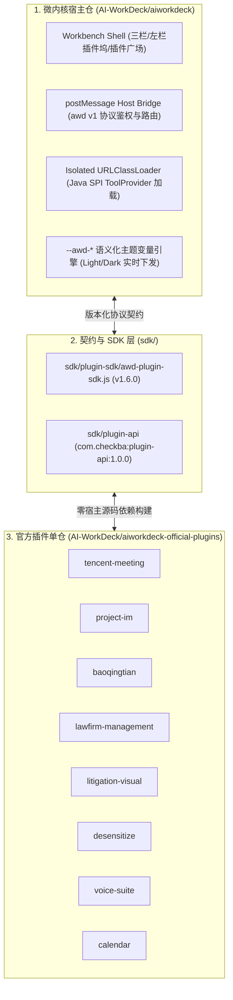

# AI WorkDeck Official Plugins (`aiworkdeck-official-plugins`)

[](./LICENSE)

**AI WorkDeck 官方插件单仓（Official Plugins Monorepo）**——采用 **微内核宿主（Microkernel Host）+ 版本化契约层（Contract/SDK）+ 沙箱插件多包单仓（Plugins Monorepo）** 三层解耦架构（参考 VS Code `vscode-pull-request-github`、Obsidian 官方插件生态与 JetBrains Plugins 演进范式）。

本仓库集中维护 AI WorkDeck 全部 **8 款官方插件**、前端桥接 SDK（`sdk/plugin-sdk/awd-plugin-sdk.js` `v1.6.0`）以及后端插件 SPI（`sdk/plugin-api` `com.checkba:plugin-api:1.0.0`）。

---

## 1. 官方插件总览（8 款全量覆盖）

| 插件 ID | 名称 | 类别 | 架构形态 | 核心能力 |
| :--- | :--- | :--- | :--- | :--- |
| [`tencent-meeting`](./plugins/tencent-meeting) | **腾讯会议** | 效率工具 | Sandbox Web + Java SPI JAR + Skill | 读取本机腾讯会议录像/转写/纪要，按案件归档，AI 起草律所会议纪要与待办 |
| [`project-im`](./plugins/project-im) | **项目沟通 (IM)** | 团队协作 | Sandbox Web + Host IM Bridge | 案件群聊、客户协作沟通、附件权限管控（内部/客户可见）、拖拽文件入 AI 材料区 |
| [`baoqingtian`](./plugins/baoqingtian) | **包晴天** | 案源协同 | Sandbox Web + Java SPI JAR (ECDH 端到端加密) | 连接包晴天当事人案源与咨询笔记，导入案件卷宗材料 |
| [`lawfirm-management`](./plugins/lawfirm-management) | **律所管理** | 律所运营 | Sandbox Web + Host LawFirm Bridge | 收案审批流、利益冲突检索（统一社会信用代码/当事人穿透）、合规风控、财务收费与主任驾驶舱 |
| [`litigation-visual`](./plugins/litigation-visual) | **诉讼可视化** | 争议解决 | Sandbox Web + Skill + Native Pack (`litviz`) | 从判决书/合同/证据抽取语义地图，确定性生成案件时间轴、法律关系图、股权控制图、流程图（`.drawio`/`.svg`/`.png`） |
| [`desensitize`](./plugins/desensitize) | **脱敏与复敏** | 合规监管 | Sandbox Web + Host Sensitive Engine + Skill | 本地零大模型规则脱敏（公司/百家姓姓名/信用代码/身份证校验位核验/执业证号）与加密映射表口令复敏 |
| [`voice-suite`](./plugins/voice-suite) | **语音转文字与朗读** | 效率工具 | Sandbox Web + Host Voice Bridge + Skill | 庭审/会谈录音转写（ASR 说话人分离 + 法律热词增强）、文书选区多角色倍速朗读（TTS）与法律笔录整理 |
| [`calendar`](./plugins/calendar) | **日历与审限** | 效率工具 | Sandbox Web + Host Calendar Bridge + Skill | 开庭排期、民事判决/裁定上诉期（15日/10日）与保全续封预警推算（《民诉法》第85条）、AI 扫描传票提取日程 |

---

## 2. 顶级架构设计：为什么以及如何拆分？

详细架构蓝图请参阅 [`docs/ARCHITECTURE.md`](./docs/ARCHITECTURE.md)。核心分层原则：



1. **为什么不用 1 个插件 1 个仓库（Polyrepo），而是「官方插件独立 Monorepo」？**
   - 8 款插件共享同一套 `sdk/plugin-sdk/awd-plugin-sdk.js`、同一套 `sdk/plugin-api` SPI、同一套 `--awd-*` 暗黑/亮色主题规范、同一套确定性 `.zip` 打包器与 SPDX 许可证门禁。
   - 若拆成 8 个零散仓库，每次 SDK 升级都需跨 8 个仓库发 PR；集中在一个 `aiworkdeck-official-plugins` 单仓内，既彻底卸下了主仓 `AI-WorkDeck/aiworkdeck` 的业务体积与构建负担，又保持了官方插件之间的统一工程标准与原子化验证。
2. **绞杀者模式（Strangler Fig Pattern）平滑演进**：
   - **第一代内置插件**（诉讼可视化、脱敏、语音、日历）原本以紧耦合 Vue 组件形态写在主仓 `frontend/src/components/` 中。
   - 在本仓中，这 4 款插件已全部升级为标准 `manifest.json + sandbox web/ + skill/` 独立插件包，同时主仓保留过渡期宿主桥接适配器，确保存量桌面端（`v0.61.x` / `v0.62.x`）零断层平滑演进。

---

## 3. 快速构建与测试

### 环境要求
- **Node.js** `>= 20`（运行沙箱 DOM 单元测试与 SPDX 检查）
- **JDK** `21` + **Maven** `>= 3.9`（编译 `sdk/plugin-api` 及含后端 JAR 的插件）
- **Python 3**（生成确定性可复现 `.zip` 插件包与 `dist/catalog.json`）

### 一键全量构建与验证

```bash
npm install
npm run verify
```

构建完成后，所有产物输出在 `dist/` 目录：
- `dist/tencent-meeting-0.1.0.zip`
- `dist/project-im-0.1.0.zip`
- `dist/baoqingtian-0.1.0.zip`
- `dist/lawfirm-management-0.1.0.zip`
- `dist/litigation-visual-1.1.0.zip`
- `dist/desensitize-2.3.0.zip`
- `dist/voice-suite-1.0.0.zip`
- `dist/calendar-1.0.0.zip`
- `dist/catalog.json`（含 SHA-256 校验和、权限清单与元数据，供插件广场与构建流水线拉取）
- `dist/SHA256SUMS`

---

## 4. 开源协议

本仓库全部源码采用 **[GNU Affero General Public License v3.0 or later (AGPL-3.0-or-later)](./LICENSE)** 授权，所有一方法律科技插件源码文件均遵循强制 SPDX 头规范并通过 CI 自动门禁检查。
